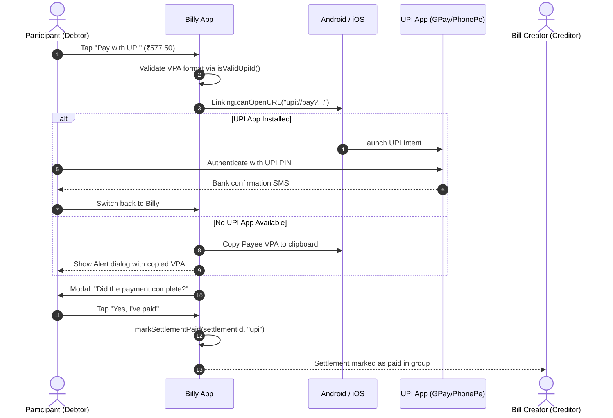

# Billy — AI-Powered Bill Splitter for India

<p align="center">
  
</p>

<p align="center">
  <em>Every Bill Matters. Snap a receipt. Split the bill. Pay over UPI. Done in under 60 seconds.</em>
</p>

<p align="center">
  
  
  
  
  
  
  
</p>

<p align="center">
  
</p>

---

## Table of Contents

1. [Executive Summary & Background](#executive-summary--background)
2. [Problem Statement](#problem-statement)
3. [Key Features](#key-features)
4. [Architecture & System Design](#architecture--system-design)
5. [OCR & AI Parsing Pipeline](#ocr--ai-parsing-pipeline)
6. [Settlement Mathematics & Edge Cases](#settlement-mathematics--edge-cases)
7. [UPI Deep Linking & Payment Handoff](#upi-deep-linking--payment-handoff)
8. [Data Contracts & TypeScript Schemas](#data-contracts--typescript-schemas)
9. [Project Directory Structure](#project-directory-structure)
10. [Prerequisites & Development Environment](#prerequisites--development-environment)
11. [Installation & Setup](#installation--setup)
12. [Environment Variables](#environment-variables)
13. [Firebase & Native Configuration](#firebase--native-configuration)
14. [Available Scripts & Diagnostics](#available-scripts--diagnostics)
15. [Limitations & Honest Caveats](#limitations--honest-caveats)
16. [Security Considerations](#security-considerations)
17. [Roadmap](#roadmap)
18. [Engineering Highlights & Design Decisions](#engineering-highlights--design-decisions)
19. [Screen-to-Route Mapping](#screen-to-route-mapping)
20. [Team & Credits](#team--credits)

---

## Executive Summary & Background

**Billy** is a mobile-first expense-splitting application specifically tailored for the Indian dining and payment ecosystem. 

When friends dine together in India, one person typically pays the entire bill at the counter. What follows is a tedious cycle of manual receipt reading, arithmetic gymnastics over GST and service charges, disagreements over who ordered which dish, and awkward manual transfers over WhatsApp or separate UPI apps.

Billy eliminates this entire friction loop. By combining **multimodal Gemini AI** with an intelligent **Indian receipt parsing engine**, **penny-precise settlement math**, and **native UPI deep linking**, Billy transforms a photo of any crumpled paper receipt into settled peer-to-peer payments in under a minute.

> [!NOTE]
> Billy was originated and designed under **Thynk Unlimited** (Team Billy) around the guiding principle: *"Every Bill Matters — Split bills, not friendships."* The accompanying pitch deck is preserved in [Billy.pdf](./Billy.pdf).

---

## Problem Statement

### Why Existing Expense Apps Fall Short

Existing expense-splitting apps (Splitwise, Settle Up, Tricount, Splitkaro) suffer from four major structural flaws when applied to dining in India:

1. **Manual Data Entry Burden:** Splitting a 15-item restaurant bill requires someone to painstakingly type every item, price, and participant on a smartphone keyboard while others wait.
2. **Coarse Splitting Defaults:** Most apps default to an equal split. If one person ordered a ₹120 mocktail while others ordered ₹850 platters and drinks, an equal split is fundamentally unfair.
3. **Indian Tax & Surcharge Complexity:** Indian restaurant receipts feature intricate combinations of **CGST (2.5%)**, **SGST (2.5%)**, **Service Charges (5–10%)**, **Packaging Fees**, **Discounts**, and **Round-Off adjustments**. Typical apps ignore these or force users to manually compute individual tax shares.
4. **Disjointed Payment Handoff:** Calculating "who owes what" is useless without settlement. Users have to switch between apps, manually enter UPI IDs, copy decimal amounts, and cross-verify screenshots.

### The Billy Solution

```
┌─────────────────┐       ┌─────────────────┐       ┌─────────────────┐       ┌─────────────────┐
│   Snap Photo    │ ──▶   │  AI Extracts    │ ──▶   │ Tap to Assign   │ ──▶   │ One-Tap UPI Pay │
│  (Camera/Crop)  │       │ (Items & Taxes) │       │ (Person / Item) │       │ (GPay/PhonePe)  │
└─────────────────┘       └─────────────────┘       └─────────────────┘       └─────────────────┘
```

Billy solves this in a single continuous flow:
- **0 manual typing** for menu items, prices, or charges.
- **Fair proportional distribution** of taxes, service fees, and discounts.
- **Penny-precise rounding** that guarantees mathematically closed splits.
- **Direct launch** into the user's preferred UPI app (Google Pay, PhonePe, Paytm, BHIM, Cred) with pre-filled payee, amount, and note.

---

## Key Features

### 📸 Receipt Capture & Pre-processing
- **Dual Capture Methods:** Take an instant photo using the device camera (`expo-camera`) or pick high-resolution images from the system gallery (`expo-image-picker`).
- **AI Document Detection & Auto-Crop:** `optimizer.ts` uses Gemini Vision to detect receipt corner boundaries within cluttered images and crops the document with a 2% safety margin.
- **Interactive Image Editor (`edit-image.tsx`):** Manual pinch-to-zoom, 90° rotation, and freeform crop before running OCR.
- **Bandwidth & Memory Compression:** High-resolution camera photos are downscaled to 1200px width at 0.8 JPEG quality (`expo-image-manipulator`) before network transmission, maintaining razor-sharp character fidelity while reducing token usage and latency.
- **Zoomable Inspector (`FullScreenViewer.tsx`):** Review items alongside an interactive, pinch-to-zoom viewer of the physical receipt with OCR block highlights.

### 🤖 Multi-Stage OCR & Intelligent Parsing
- **Two-Stage Gemini AI Architecture:**
  - **Stage 1 (Raw OCR):** `gemini-2.0-flash` extracts raw text in plain-text mode, preventing model truncation.
  - **Stage 2 (Structured Parsing):** `gemini-flash-lite-latest` transforms raw text into a strictly typed `ParsedBill` schema.
- **Offline & Fallback Redundancy:**
  - **Google Cloud Vision API (Optional):** Generates word-level bounding boxes for item-to-image synchronized visual highlighting.
  - **On-Device ML Kit:** Native `@react-native-ml-kit/text-recognition` provides offline OCR when network connectivity drops.
  - **Local Regex Fallback Parser:** 4 deterministic regex pattern matchers specifically tuned for Indian thermal printer receipt formats when Gemini is unreachable.
- **Network Resilience:** Automatic exponential backoff retry (2s → 4s → 8s, up to 4 attempts) for HTTP 429 rate limits and 503/504 gateway timeouts.
- **Abort Controller Support:** Instantly cancel pending network OCR tasks if the user backs out.

### 📝 Bill Review & Real-Time Mutation
- **Non-Receipt Guard (`isBill`):** Rejects selfies, memes, landscape photos, and screenshots with clear error feedback.
- **Header Intelligence:** Automatically distinguishes commercial brand names (e.g. *"Plan B"*) from parent legal entities (e.g. *"V&RO Hospitality Pvt Ltd"*).
- **Parent-Child & Modifier Grouping:** Recognizes combos and platters where unpriced child items belong to a priced parent (e.g., *"Tuesday Dozen"* with child sauces).
- **Low Confidence Flagging:** Items extracted with < 0.8 confidence are visually flagged with warning indicators for quick review.
- **Automatic Recalculation Engine (`recalculateBillTotals.ts`):** Editing an item price, modifying a quantity, or deleting a dish instantly recalculates subtotal, taxes, service charges, and grand total in real-time.

### ⚖️ Deterministic Bill Splitting
- **Equal Split:** Divides the grand total equally with automated remainder correction on the final participant.
- **Item-Wise Split:** Assign items to specific consumers. Dishes shared by 2 or more people have their base cost divided evenly among claimants.
- **Proportional Surcharge Distribution:** Taxes (CGST, SGST, VAT) and service charges are distributed strictly in proportion to each person's consumed subtotal, NOT equally.
- **Unassigned Item Safeguard:** Any item left unassigned is automatically split equally across all participants so no rupee is left unallocated.
- **Dual Assignment UX:**
  - *By Person:* Select a participant, then tap all items they consumed.
  - *By Item:* Select a food item, then toggle checkboxes for everyone who shared it.

### 👥 Contacts & Reusable Groups
- **Native Address Book Integration (`expo-contacts`):** Seamless contact picker with search.
- **Three-Layer Contact Deduplication:**
  1. Filters out blank names and literal string `"null"`.
  2. Deduplicates identical native contact IDs.
  3. Deduplicates identical normalized E.164 phone numbers (e.g., `+91 98765 43210` vs `09876543210`).
- **Reusable Contact Groups (`contactGroupStore.ts`):** Create named cohorts (e.g., *"Flatmates"*, *"Office Lunch Crew"*). Starting a new bill allows 1-tap pre-filling of all participants.
- **Snapshot Isolation:** A completed bill freezes its participant list into the `BillGroup`. Later modifications or member deletions in the contact group never corrupt historical bill records.

### 📊 Group Balances Across Multiple Bills
- **Read-Only Balance Aggregator (`groupBalances.ts`):** Evaluates all historical `BillGroup` records linked to a reusable `ContactGroup`.
- **Net Debt Ledger:** Computes what each member owes or is owed across all bills, the viewer's net balance, and total outstanding debt in the group without maintaining duplicate, volatile ledger tables.
- **Settlement Filtration:** Only outstanding (`pending`) settlement rows count toward balances. Marked `paid` transactions drop out of the active debt calculation.

### 💸 UPI Deep Linking & Payment Tracking
- **NPCI Specification Compliance:** Generates standard `upi://pay` URIs with receiver VPA, payee name, transaction note, currency (`INR`), and 2-decimal amount formatting.
- **Universal App Support:** Opens installed UPI apps directly via `expo-linking` (Google Pay, PhonePe, Paytm, BHIM, Cred, Navi, etc.).
- **Graceful Fallback:** If no UPI app is detected on the device, copies the receiver's UPI ID to the system clipboard and alerts the user.
- **Payment Confirmation Dialog:** Prevents accidental double-marking by prompting *"Did the payment go through?"* before updating status.
- **Audit Tracking:** Stores payment method (`upi`, `cash`, `other`) and timestamp (`paidAt`) on each transaction.
- **Auto-State Transition:** When all settlement rows in a `BillGroup` reach `paid`, the group status automatically transitions from `active` to `settled`.

### 🔐 Pluggable Authentication & Identity Continuity
- **Modular Provider Interface (`IAuthProvider`):** Clean separation between authentication mechanisms and store state.
- **Local Provider (Default):** Instant on-device registration using Name + Phone. Creates a deterministic local UID without requiring SMS gateway credits.
- **Firebase Auth Integration (Wired):** Full phone OTP authentication ready via `@react-native-firebase/auth`.
- **The Identity Invariant:** Billy maintains a durable `phone -> uid` mapping in storage. When upgrading an account to Firebase Phone Auth, the core `uid` is preserved so all previously scanned bills, group memberships, and settlement debts remain linked without orphaning historical data.
- **Automated Verification Script:** `npm run check:auth` runs 7 automated regression assertions against the identity engine.

---

## Architecture & System Design

### Design Philosophy

1. **Logic First, UI Second:** All core math, parsing, and state updates live in framework-agnostic TypeScript services. UI screens are thin presentation shells that read from stores and invoke services.
2. **Framework-Agnostic Service Layer:** Zero React or React Native dependencies in `mobile/services/`. These modules can run identically in a Node.js backend, a web app, or a CLI script.
3. **Module-Level Singletons over Redux/Context:** React Context causes cascading re-renders across the tree on every state update. Billy uses singleton stores holding state in closures with selective subscription models.

### System Architecture Diagram

```
┌────────────────────────────────────────────────────────────────────────┐
│                        React Native UI Layer                           │
│  app/(tabs) · app/group/[id] · app/review-items · app/participants      │
└───────────────────────────────────┬────────────────────────────────────┘
                                    │ Hooks: useAuth, useBillStore,
                                    │        useGroups, useContactGroups
┌───────────────────────────────────▼────────────────────────────────────┐
│                       Singleton Store Layer                            │
│  authStore.ts   ·   billStore.ts   ·   groupStore.ts   ·  contactGroup │
│                   (subscribe() → triggers React setState)              │
└─────────┬──────────────────────────────────────────┬───────────────────┘
          │ AsyncStorage                             │ Service calls
┌─────────▼──────────────────────────┐   ┌───────────▼───────────────────┐
│     Persistent Storage             │   │       Pure Service Layer      │
│  @billy_auth_session               │   │  calculateSettlement.ts       │
│  @billy_auth_identity_map          │   │  recalculateBillTotals.ts     │
│  @billy_groups                     │   │  groupBalances.ts             │
│  @billy_contact_groups             │   │  matchItems.ts  ·  upi.ts     │
└────────────────────────────────────┘   └───────────┬───────────────────┘
                                                     │ External APIs
                                         ┌───────────▼───────────────────┐
                                         │   Gemini 2.0 Flash (OCR)      │
                                         │   Gemini Flash Lite (Parse)   │
                                         │   Google Cloud Vision API     │
                                         │   ML Kit On-Device OCR        │
                                         │   UPI Payment Schemes         │
                                         └───────────────────────────────┘
```

### Complete User Flowchart

```mermaid
flowchart TD
    Start(["📱 App Launch"]) --> AuthCheck{"Authenticated?"}
    AuthCheck -->|No| LoginScreen["🔑 Login Screen\nName + Phone"]
    LoginScreen --> Onboarding["💳 Optional UPI ID Setup"]
    Onboarding --> HomeTab
    AuthCheck -->|Yes| HomeTab["🏠 Home Screen\napp/(tabs)/index.tsx"]

    HomeTab --> ScanChoice{"Capture Method"}
    ScanChoice -->|Camera| SnapPhoto["📸 Camera Capture"]
    ScanChoice -->|Gallery| PickPhoto["🖼️ Gallery Picker"]

    SnapPhoto --> DocDetect["🔍 AI Document Detection\noptimizer.ts (auto-crop)"]
    PickPhoto --> DocDetect
    DocDetect --> EditImage["✂️ Image Editor\nCrop, Rotate, Zoom"]
    EditImage --> OCRStage["🤖 Stage 1: Gemini Vision OCR\nImage → Raw Text\n(ML Kit offline fallback)"]
    OCRStage --> ParseStage["📝 Stage 2: Gemini Flash Lite\nRaw Text → ParsedBill JSON\n(Regex fallback)"]
    ParseStage --> ReviewItems["✏️ Review Items Screen\nAdd, edit, delete, verify charges\nrecalculateBillTotals.ts"]

    ReviewItems --> AddParticipants["👥 Add Participants\nDevice Contacts or Reusable Group"]
    AddParticipants --> SelectPayer["💰 Select Who Paid"]
    SelectPayer --> SplitMethod{"Split Method?"}

    SplitMethod -->|Equal| EqualSummary["📊 Equal Split Summary\nPenny-rounding remainder applied"]
    SplitMethod -->|Item-Wise| AssignItems["🍽️ Assign Items\nBy Person or By Item"]
    AssignItems --> ItemSummary["📊 Item-Wise Summary\nProportional tax & charge distribution"]

    EqualSummary --> CreateGroup["📁 Save BillGroup\nPersist to AsyncStorage"]
    ItemSummary --> CreateGroup

    CreateGroup --> GroupDetail["📋 Group Detail Screen\napp/group/[id].tsx"]
    GroupDetail --> TriggerUPI["💸 Tap Settle Up\nLaunch upi://pay deep link"]
    TriggerUPI --> ConfirmPayment{"Confirm Payment?"}
    ConfirmPayment -->|Yes| MarkPaid["✅ Mark Settlement as Paid\nAuto-settle group when all paid"]
    ConfirmPayment -->|No| GroupDetail
    MarkPaid --> HistoryTab["📂 Archived in History Tab"]
```



---

## OCR & AI Parsing Pipeline

### Why the OCR Pipeline is Split into Two Stages

During early development, we attempted to instruct Gemini Vision (`gemini-2.0-flash`) to perform OCR and structured JSON formatting in a single prompt with `response_mime_type: "application/json"`.

**The Failure:** When presented with complex receipt layouts in JSON mode, Gemini synthesized the document and returned a terse, 121-character summary object containing only the restaurant name and grand total. More than 60% of individual line items were discarded.

**The Solution:** We decoupled text perception from text structuring into two specialized stages:

```
┌─────────────────────────────────┐
│     Raw Receipt Image (JPEG)    │
└────────────────┬────────────────┘
                 │
                 ▼
┌─────────────────────────────────┐
│   Stage 1: Gemini 2.0 Flash     │  Raw text mode (NO JSON schema, no token cap)
│            ocr.ts               │  Extracts 100% of characters line-by-line
└────────────────┬────────────────┘
                 │ Raw OCR string
                 ▼
┌─────────────────────────────────┐
│  Stage 2: Gemini Flash Lite     │  Strict JSON schema (ParsedBill)
│          parseBill.ts           │  Understands combos, discounts, GST, charges
└────────────────┬────────────────┘
                 │
                 ▼
┌─────────────────────────────────┐
│      Typed ParsedBill Object    │
└─────────────────────────────────┘
```

This 2-stage architecture increased menu line-item extraction accuracy from **~40% to ~98%** across Indian restaurant bills.

### Multi-Tier Fallback Hierarchy

Billy is engineered to function under adverse network conditions:

| Tier | Component | Trigger Condition | Output |
|---|---|---|---|
| **Primary OCR** | Gemini 2.0 Flash (`ocr.ts`) | Default network available | Raw text stream with line indexes |
| **Offline OCR** | ML Kit Text Recognition (`mlkitOcr.ts`) | Network offline or native build fallback | On-device OCR block extraction |
| **Highlighting** | Google Cloud Vision (`visionOcr.ts`) | `EXPO_PUBLIC_VISION_API_KEY` present | Pixel-percent bounding boxes for image sync |
| **Primary Parser** | Gemini Flash Lite (`parseBill.ts`) | Default network available | Validated `ParsedBill` JSON |
| **Fallback Parser** | Local Regex Matcher (`parseBill.ts`) | Gemini 429/timeout/offline | 4 pattern matchers extract items and prices |

#### Local Regex Matcher Patterns

When the AI parser cannot be reached, the built-in regex engine parses raw OCR lines using four battle-tested Indian receipt expressions:
1. `NAME <spaces> QTY <spaces> RATE <spaces> AMOUNT` (Standard multi-column table)
2. `NAME <spaces> QTY <spaces> AMOUNT` (Single rate column)
3. `NAME <spaces> ₹?AMOUNT` (Simple single-item lines)
4. `NAME <spaces> QTY x RATE` (POS compact formatting)

---

## Settlement Mathematics & Edge Cases

The settlement engine (`calculateSettlement.ts`) is a **stateless, pure mathematical function**. It has zero dependencies, zero side-effects, and is 100% deterministic.

### 1. The Penny-Rounding Problem & Correction

When an amount is divided equally or proportionally, fractional paise inevitably result in rounding discrepancies.

**Example:** ₹100 split 3 ways:
$$\frac{100}{3} = 33.3333...$$
Rounded to 2 decimal places: ₹33.33 each.
$$33.33 \times 3 = 99.99 \quad (\text{Deficit: } ₹0.01)$$

**The Billy Invariant:**
$$\sum_{i=1}^{N} \text{ParticipantTotal}_i = \text{GrandTotal}$$

**Resolution Algorithm:**
1. Round participants $1$ through $N-1$ to 2 decimal places using standard half-up rounding.
2. Participant $N$ receives the remainder:
$$\text{Total}_N = \text{GrandTotal} - \sum_{i=1}^{N-1} \text{Total}_i$$
This guarantees that the sum of settlements matches the physical bill to the exact rupee and paise.

### 2. Proportional Surcharge Distribution

In an item-wise split, charging taxes and service charges equally is unfair to individuals who consumed low-cost items.

Billy calculates each participant's tax and service charge liability in exact proportion to their personal food and beverage subtotal:

$$\text{PersonRatio}_i = \frac{\text{PersonalItemsSubtotal}_i}{\text{BillItemsSubtotal}}$$

$$\text{TaxShare}_i = \text{Round}_2\left(\text{PersonRatio}_i \times \text{TotalGST}\right)$$

$$\text{ServiceChargeShare}_i = \text{Round}_2\left(\text{PersonRatio}_i \times \text{TotalServiceCharge}\right)$$

$$\text{AdditionalChargesShare}_i = \text{Round}_2\left(\text{PersonRatio}_i \times \text{TotalAdditionalCharges}\right)$$

### 3. Worked Math Walkthrough

Consider a real Indian restaurant bill:
- **Items:**
  - Paneer Butter Masala: ₹350 (Alice)
  - Garlic Naan (x2): ₹150 (Alice and Bob shared, ₹75 each)
  - Chicken Biryani: ₹450 (Bob)
  - Fresh Lime Soda: ₹100 (Charlie)
- **Subtotal:** ₹1,050.00
- **CGST (2.5%):** ₹26.25
- **SGST (2.5%):** ₹26.25
- **Service Charge (5%):** ₹52.50
- **Total Bill:** ₹1,155.00
- **Payer:** Alice paid the entire ₹1,155.00

#### Step A: Personal Items Subtotal
- Alice: $350 + 75 = ₹425.00$ ($40.48\%$)
- Bob: $450 + 75 = ₹525.00$ ($50.00\%$)
- Charlie: $100 = ₹100.00$ ($9.52\%$)

#### Step B: Total Non-Item Surcharges
$$\text{Surcharges} = 26.25 + 26.25 + 52.50 = ₹105.00$$

#### Step C: Proportional Share Calculation
- **Alice:** $425.00 + (0.40476 \times 105.00) = 425.00 + 42.50 = ₹467.50$
- **Bob:** $525.00 + (0.50000 \times 105.00) = 525.00 + 52.50 = ₹577.50$
- **Charlie:** $100.00 + (0.09524 \times 105.00) = 100.00 + 10.00 = ₹110.00$

$$\text{Sum} = 467.50 + 577.50 + 110.00 = ₹1,155.00 \quad (\text{Exact Match})$$

#### Step D: Peer-to-Peer Transactions Generated
Because Alice paid the counter:
- **Bob owes Alice:** ₹577.50
- **Charlie owes Alice:** ₹110.00
- **Alice owes:** ₹0.00 (Self-settled)

---

## UPI Deep Linking & Payment Handoff

Billy interacts directly with India's **Unified Payments Interface (UPI)** via NPCI URI specifications.

### The URI Specification

Payment links are constructed dynamically in `upi.ts`:

```
upi://pay?pa={upiId}&pn={receiverName}&am={amount}&cu=INR&tn={note}
```

| Parameter | Key | Description | Example |
|---|---|---|---|
| Payee VPA | `pa` | Validated Virtual Payment Address | `rahul@okaxis` |
| Payee Name | `pn` | URL-encoded display name | `Rahul%20Sharma` |
| Amount | `am` | Exact formatted amount (2 decimals) | `577.50` |
| Currency | `cu` | Currency code (must be INR) | `INR` |
| Note | `tn` | URL-encoded transaction memo | `Billy%20split%20for%20Plan%20B` |

### Payment Lifecycle Flow



---

## Data Contracts & TypeScript Schemas

All core domain models are defined in `mobile/types/`:

### 1. `ParsedBill` (`types/bill.ts`)

```typescript
export interface ParsedBill {
  isBill: boolean;             // Rejects non-bill images
  restaurant: string;         // Brand name (e.g. "Toit")
  legalName?: string;         // Entity name (e.g. "Toit Brewpub Pvt Ltd")
  billNumber: string;         // Invoice/Bill #
  date: string;               // Receipt date string
  items: BillItem[];          // Parsed line items
  subtotal?: number | null;    // Sum of items
  charges?: ChargeInfo[];     // Canonical list of taxes & fees
  total: number;              // Grand total
  imageWidth?: number;        // Natural image dimensions
  imageHeight?: number;
}
```

### 2. `BillItem` (`types/bill.ts`)

```typescript
export interface BillItem {
  id: string;                 // Stable UUID for React state
  name: string;               // Menu item name
  quantity: number;           // Quantity ordered
  unitPrice?: number;         // Unit rate
  amount: number;             // Total price for line
  price: number;              // Alias for amount
  children?: string[];        // Unpriced sub-items (combo flavours)
  modifiers?: { name: string; amount: number }[]; // Priced add-ons
  confidence: number;         // 0 to 1 confidence score (<0.8 flagged)
  lineIndex?: number;         // Source OCR line index
  boundingBox?: BoundingBox;  // Resolution-independent % coordinates
}
```

### 3. `BillGroup` & `GroupSettlement` (`types/group.ts`)

```typescript
export interface BillGroup {
  id: string;                 // UUID / Firestore Document ID
  title: string;              // e.g. "Dinner at Toit"
  createdBy: string;          // User UID of the creator
  participants: Person[];     // Snapshot of participants
  settlements: GroupSettlement[]; // Final calculated debt transactions
  totalAmount: number;        // Grand total
  createdAt: string;          // ISO 8601
  updatedAt: string;          // ISO 8601
  status: "active" | "settled"; // Transitions to settled when all paid
  billSnapshot?: ParsedBill;  // Frozen original bill data
  contactGroupId?: string;    // Backward link to reusable cohort
}

export interface GroupSettlement {
  fromUserId: string;         // Debtor UID
  toUserId: string;           // Creditor UID
  amount: number;             // Settlement amount (INR)
  status: "pending" | "paid"; // Payment status
  paidAt?: string;            // Timestamp when marked paid
  paymentMethod?: "upi" | "cash" | "other";
}
```

### 4. `ContactGroup` (`types/group.ts`)

```typescript
export interface ContactGroup {
  id: string;                 // Local UUID
  name: string;               // Cohort title (e.g. "Flatmates")
  members: GroupMember[];     // Saved participants (name + phone)
  createdAt: string;
  updatedAt: string;
}
```

---

## Project Directory Structure

```
billy/
├── mobile/                                # React Native application root
│   ├── app/                               # Expo Router file-based routes
│   │   ├── (tabs)/                        # Bottom tab navigator
│   │   │   ├── _layout.tsx                # Tab bar layout & styling
│   │   │   ├── index.tsx                  # Home screen — scan or initiate bill
│   │   │   ├── pay-bills.tsx              # Active groups & pending settlements
│   │   │   ├── groups.tsx                 # Reusable contact groups list
│   │   │   ├── history.tsx                # Settled groups archive & statistics
│   │   │   └── profile.tsx                # User profile, UPI ID & session
│   │   ├── contact-group/
│   │   │   └── [id].tsx                   # Contact group detail & net balances
│   │   ├── group/
│   │   │   └── [id].tsx                   # Settlement group detail & payment hub
│   │   ├── _layout.tsx                    # Root layout with auth session guard
│   │   ├── login.tsx                      # Phone number & name registration
│   │   ├── onboarding.tsx                 # Post-login UPI ID collection
│   │   ├── optimizing.tsx                 # AI document boundary detection screen
│   │   ├── preview.tsx                    # Image preview before OCR
│   │   ├── edit-image.tsx                 # Manual crop, pinch-to-zoom, rotate
│   │   ├── ocr.tsx                        # OCR progress screen with backoff
│   │   ├── review-items.tsx               # Interactive bill item review & edit
│   │   ├── participants.tsx               # Participant selection & payer pick
│   │   ├── choose-split-method.tsx        # Equal vs Item-wise selection
│   │   ├── equal-split-summary.tsx        # Equal split breakdown & confirmation
│   │   ├── itemwise-split-summary.tsx     # Item assignment & proportional summary
│   │   ├── split.tsx                      # Legacy split router
│   │   └── test-models.tsx                # Developer sandbox for OCR models
│   │
│   ├── services/                          # Framework-agnostic business logic
│   │   ├── auth/                          # Pluggable authentication system
│   │   │   ├── authProvider.ts            # IAuthProvider interface contract
│   │   │   ├── localAuthProvider.ts       # Default on-device auth provider
│   │   │   ├── firebaseAuthProvider.ts    # Firebase phone OTP provider
│   │   │   ├── initFirebaseAuth.ts        # Firebase bootstrap & error guard
│   │   │   ├── firebaseSdkContract.check.ts # Native contract sanity checks
│   │   │   └── index.ts                   # Provider registry & switch logic
│   │   ├── authStore.ts                   # Auth state singleton with durable UID map
│   │   ├── billStore.ts                   # In-memory bill session state singleton
│   │   ├── groupStore.ts                  # BillGroup state + AsyncStorage CRUD
│   │   ├── contactGroupStore.ts           # Reusable ContactGroup store
│   │   ├── ocr.ts                         # Stage 1: Gemini Vision raw text OCR
│   │   ├── parseBill.ts                   # Stage 2: Gemini Flash Lite JSON parser
│   │   ├── visionOcr.ts                   # Google Cloud Vision bounding box OCR
│   │   ├── mlkitOcr.ts                    # ML Kit on-device offline fallback OCR
│   │   ├── optimizer.ts                   # Gemini receipt boundary detector & crop
│   │   ├── calculateSettlement.ts         # Pure mathematical settlement engine
│   │   ├── recalculateBillTotals.ts       # Pure bill recalculation on mutation
│   │   ├── groupBalances.ts               # Net debt balance aggregator across bills
│   │   ├── matchItems.ts                  # Fuzzy LCS item-to-OCR block matcher
│   │   ├── upi.ts                         # UPI URI builder & deep link launcher
│   │   └── userDirectory.ts               # Local cache of known phone contacts
│   │
│   ├── components/                        # UI Components
│   │   ├── bill-split/                    # Participant & button primitives
│   │   │   ├── ParticipantCard.tsx
│   │   │   ├── ParticipantCheckbox.tsx
│   │   │   ├── PrimaryButton.tsx
│   │   │   └── SectionHeader.tsx
│   │   ├── ui/                            # Themed icons and collapsible panels
│   │   │   ├── collapsible.tsx
│   │   │   ├── icon-symbol.ios.tsx
│   │   │   └── icon-symbol.tsx
│   │   ├── AddBillSheet.tsx               # Modal sheet to start bill scan
│   │   ├── BillImagePanel.tsx             # Interactive bill view with highlights
│   │   ├── ContactPickerModal.tsx         # Deduplicated contact picker modal
│   │   ├── FullScreenViewer.tsx           # Zoomable full-screen image inspector
│   │   ├── ItemAssignmentSection.tsx      # Dual-mode item assignment matrix
│   │   ├── haptic-tab.tsx                 # Haptic feedback for tab navigation
│   │   ├── parallax-scroll-view.tsx       # Parallax header scroll wrapper
│   │   ├── themed-text.tsx                # Theme-aware Typography component
│   │   └── themed-view.tsx                # Theme-aware Surface component
│   │
│   ├── hooks/                             # React hooks (thin store bridges)
│   │   ├── useAuth.ts                     # Reactive bridge to authStore
│   │   ├── useBillStore.ts                # Reactive bridge to active billStore
│   │   ├── useGroups.ts                   # Reactive bridge to groupStore
│   │   ├── useContactGroups.ts            # Reactive bridge to contactGroupStore
│   │   ├── use-color-scheme.ts            # System color scheme listener
│   │   └── use-theme-color.ts             # Theme token resolver
│   │
│   ├── types/                             # TypeScript definitions
│   │   ├── bill.ts                        # BillItem, ParsedBill, Person, OcrBlock
│   │   ├── group.ts                       # BillGroup, GroupSettlement, ContactGroup
│   │   └── user.ts                        # User model & auth provider contracts
│   │
│   ├── utils/                             # Pure utility functions
│   │   ├── nanoid.ts                      # Collision-resistant ID generator
│   │   └── normalizePhoneNumber.ts        # E.164 phone normalizer (India default)
│   │
│   ├── scripts/                           # Tooling and diagnostic scripts
│   │   ├── checkAuthIdentity.js           # Auth identity invariant regression check
│   │   ├── reset-project.js               # Clean project reset script
│   │   └── testGeminiCrop.js              # Node test for receipt boundary crop
│   │
│   ├── constants/theme.ts                 # Color palette and typography tokens
│   ├── android/                           # Generated native Android project
│   ├── ios/                               # Generated native iOS project
│   ├── app.json                           # Expo app configuration & plugins
│   ├── tailwind.config.js                 # NativeWind Tailwind CSS config
│   └── package.json                       # Dependencies and npm scripts
│
├── assets/                                # Media & demo assets
│   └── billy-demo.gif                     # Application walkthrough animation
├── backend/                               # Future Cloud proxy backend (placeholder)
├── docs/                                  # Documentation assets & web demos
├── Billy.pdf                              # Pitch Deck by Thynk Unlimited
├── PROJECT.md                             # Internal architecture notes & changelog
└── README.md                              # ← You are here
```

---

## Prerequisites & Development Environment

### 1. System Requirements

- **Operating System:** Linux (Ubuntu 20.04+ LTS recommended), macOS (Sequoia / Sonoma), or Windows with WSL2.
- **Node.js:** `>= 20.x LTS` (`node --version`)
- **Package Manager:** `npm >= 10.x`
- **Java Development Kit:** OpenJDK 17 (Required by modern Android Gradle Plugin):
  ```bash
  sudo apt update && sudo apt install openjdk-17-jdk -y
  java -version # Verify: OpenJDK 17.x
  ```
- **Android SDK:** Installed via Android Studio. Ensure your shell profile (`~/.bashrc` or `~/.zshrc`) exports:
  ```bash
  export ANDROID_HOME=$HOME/Android/Sdk
  export PATH=$PATH:$ANDROID_HOME/emulator:$ANDROID_HOME/platform-tools:$ANDROID_HOME/tools
  ```
- **Watchman (Recommended for file watching):**
  ```bash
  sudo apt install watchman -y
  ```

### 2. External API Keys & Services

| Service | Necessity | Purpose | Where to Obtain |
|---|---|---|---|
| **Google Gemini API** | **Required** | OCR extraction & structured parsing | [Google AI Studio](https://aistudio.google.com/apikey) |
| **Firebase Project** | **Required for Native Build** | Native module compilation (`google-services.json`) | [Firebase Console](https://console.firebase.google.com/) |
| **Google Cloud Vision** | Optional | Word-level bounding boxes for image sync | [Google Cloud Console](https://console.cloud.google.com/) |

---

## Installation & Setup

### 1. Clone the Repository

```bash
git clone https://github.com/binetasaju/billy.git
cd billy/mobile
```

### 2. Install Dependencies

```bash
npm install
```

### 3. Configure Environment Variables

Create `.env` inside the `mobile/` directory:

```bash
cp .env.example .env
```

Populate the keys:

```dotenv
# Required: Google Gemini API Key for OCR & Parsing
EXPO_PUBLIC_GEMINI_API_KEY=AIzaSyYourGeminiApiKeyHere

# Optional: Google Cloud Vision API key for bounding boxes
EXPO_PUBLIC_VISION_API_KEY=AIzaSyYourCloudVisionKeyHere
```

### 4. Build and Run the App

> [!IMPORTANT]
> Billy uses **custom native modules** (`@react-native-firebase/auth`, `@react-native-ml-kit/text-recognition`). You **cannot** use Expo Go (`expo start --go`). You must run a native development build.

#### Android (Device or Emulator)
```bash
# 1. Start an Android emulator or connect a device with USB debugging enabled
adb devices

# 2. Compile and run the native debug APK
npx expo run:android
```

#### iOS (macOS only)
```bash
# Ensure CocoaPods are installed
cd ios && pod install && cd ..

# Compile and run in the iOS Simulator
npx expo run:ios
```

#### Metro Bundler Only (once native binary is installed)
```bash
npx expo start
```

---

## Environment Variables

All client-side environment variables use Expo's `EXPO_PUBLIC_` prefix:

| Variable | Required | Default | Description |
|---|---|---|---|
| `EXPO_PUBLIC_GEMINI_API_KEY` | **Yes** | *None* | Gemini API Key used by `ocr.ts`, `parseBill.ts`, and `optimizer.ts`. |
| `EXPO_PUBLIC_VISION_API_KEY` | No | *None* | Google Cloud Vision API Key for precise bounding-box coordinates. Falls back to estimated line coordinates if omitted. |

---

## Firebase & Native Configuration

Billy's codebase contains native links to `@react-native-firebase/app` and `@react-native-firebase/auth`. The Android and iOS compilation steps require configuration files from Firebase:

1. Create a Firebase project at [console.firebase.google.com](https://console.firebase.google.com).
2. Register an **Android App** with package name: `com.anonymous.mobile`.
3. Download `google-services.json` and ensure it is placed at both:
   - `mobile/google-services.json`
   - `mobile/android/app/google-services.json`
4. Register an **iOS App** (bundle ID `com.anonymous.mobile`) and place `GoogleService-Info.plist` at `mobile/ios/mobile/GoogleService-Info.plist`.
5. Under Firebase Console → Authentication → Sign-in method, enable **Phone**.

> [!TIP]
> **Out-of-the-box Behavior:** Billy defaults to `localAuthProvider.ts`, which runs offline without sending SMS OTPs. To enable Firebase Phone OTP, import `initFirebaseAuth` and call `initFirebaseAuth()` during application bootstrap in `mobile/app/_layout.tsx`.

---

## Available Scripts & Diagnostics

Execute these commands from `mobile/`:

| Command | Action |
|---|---|
| `npm run start` | Launch Metro bundler server (`npx expo start`) |
| `npm run android` | Build and launch the Android native debug app (`npx expo run:android`) |
| `npm run ios` | Build and launch the iOS native debug app (`npx expo run:ios`) |
| `npm run lint` | Run ESLint across all TypeScript code (`expo lint`) |
| `npm run check:auth` | **Execute the 7 automated auth regression checks** (`scripts/checkAuthIdentity.js`) |
| `npm run web` | Start web dev server (limited — native OCR modules not linked) |

### Identity Invariant Test Output

Run `npm run check:auth`:

```bash
$ npm run check:auth

> mobile@1.0.0 check:auth
> node scripts/checkAuthIdentity.js

auth identity regression check

  ✓ legacy session links Firebase in place; uid preserved
  ✓ logout → Firebase sign-in rejoins the canonical uid
  ✓ same number typed as '98765 43210' still rejoins
  ✓ new number gets uid === firebaseUid
  ✓ a different number does not inherit the legacy uid
  ✓ repeat Firebase sign-in is idempotent
  ✓ updateUser cannot rewrite uid

7 checks passed.
```

---

## Limitations & Honest Caveats

We believe in complete engineering honesty. The following are real architectural boundaries of Billy today:

1. **Self-Reported Settlements (No Server Verification):**
   - UPI integration is implemented via deep-linking (`upi://pay`).
   - Billy launches the native UPI payment screen but **does not act as an RBI-regulated payment aggregator**.
   - It cannot programmatically inspect your bank statement. Settlement status is **self-reported**: the payer or payee taps "Confirm Payment" to mark a settlement paid.
2. **Local-First Storage (AsyncStorage):**
   - All bills, settlements, contacts, and identities are stored on the local device.
   - If a user deletes the app or clears application data, local bills are wiped.
   - Cloud Firestore synchronization across devices is architected in the schema but not yet deployed.
3. **Receipt Quality Sensitivity:**
   - Thermal receipts that are heavily faded, wrinkled, torn, or photographed in low light can result in OCR misreads.
   - The interactive review screen (`review-items.tsx`) is designed specifically so users can adjust or add missing items in seconds.

---

## Security Considerations

> [!WARNING]
> **Client-Side Gemini API Key:** Because Expo bundles `EXPO_PUBLIC_` environment variables into client JavaScript, the Gemini API key in `mobile/.env` can be extracted by a determined user decompiling the APK/IPA.

### Security Posture & Recommendations

- **Development Build:** Suitable for personal use and private testing.
- **Production Distribution Path:** Before publishing to Google Play or Apple App Store, Gemini API calls should be routed through a backend proxy (e.g. Firebase Cloud Functions or a Node.js microservice in `backend/`). The mobile client would authenticate with a Firebase JWT, and the backend proxy would securely append the server-side `GEMINI_API_KEY`.
- **Firebase Keys:** The `google-services.json` file contains Firebase API keys which are [safe to distribute in client binaries](https://firebase.google.com/docs/projects/api-keys) when Firebase Security Rules are properly configured.
- **Zero Financial Data:** Billy never collects, stores, or handles credit card numbers, bank passwords, or UPI MPINs. All credentials remain inside NPCI-certified UPI banking apps.

---

## Roadmap

| Milestone | Feature | Description | Priority |
|---|---|---|---|
| **Phase 3A** | **Cloud Firestore Sync** | Real-time multi-device synchronization so all participants see live settlement updates on their own phones | 🔴 P0 |
| **Phase 3B** | **API Key Proxy** | Node.js backend proxy in `backend/` to safeguard AI keys from APK extraction | 🔴 P0 |
| **Phase 3C** | **Firebase Phone OTP** | Switch default provider to active Firebase Phone verification | 🔴 P0 |
| **Phase 4A** | **QR Code Bill Join** | Display a dynamic QR code on the payer's phone; friends scan to join the bill instantly without phone numbers | 🟡 P1 |
| **Phase 4B** | **Push Notifications** | FCM notifications when a friend adds you to a bill or marks a payment as complete | 🟡 P1 |
| **Phase 4C** | **Automated Unit Tests** | Comprehensive Jest test suites for `calculateSettlement`, `groupBalances`, and `parseBill` | 🟡 P1 |
| **Phase 5A** | **Receipt Image Storage** | Firebase Storage integration to store and retrieve historical receipt photos | 🟢 P2 |
| **Phase 5B** | **Multi-Currency** | Support for splitting international travel bills in USD, EUR, GBP, and AED | 🟢 P2 |

---

## Engineering Highlights & Design Decisions

### 1. Zero-React Service Layer
The entire `mobile/services/` folder contains **zero imports from React or React Native** (with the sole exception of `upi.ts` which imports `Linking` and `Alert`). The calculation engine, group balance algorithms, OCR parsing, and stores can be unit-tested in pure Node.js or ported to a web dashboard without rewriting any business logic.

### 2. Identity Invariant Preservation
In `authStore.ts`, when a user signs in via Firebase, their account identity (`uid`) is decoupled from the `firebaseUid`. If a user already scanned 10 bills on their device under a local session, verifying their phone number links the Firebase token without rewriting their historical `uid`, ensuring no past debts or bills are orphaned.

### 3. Contact Deduplication Algorithm
Device address books are notoriously noisy. `ContactPickerModal.tsx` implements a 3-tier filtration pipeline:
```typescript
// 1. Omit blank / invalid contact names
if (!contact.name || contact.name.trim() === "" || contact.name.toLowerCase() === "null") return;

// 2. Deduplicate by unique device contact ID
if (seenIds.has(contact.id)) return;
seenIds.add(contact.id);

// 3. Normalize and deduplicate by E.164 phone number (+91...)
const normalizedPhone = normalizePhoneNumber(phone);
if (seenPhones.has(normalizedPhone)) return;
seenPhones.add(normalizedPhone);
```

### 4. LCS Fuzzy Item Matching
When linking parsed JSON items to physical image bounding boxes for visual highlighting, OCR text and parsed names often have subtle spacing differences. `matchItems.ts` applies a **Longest Common Subsequence (LCS)** similarity score to map items accurately to their exact coordinates on the original receipt image.

---

## Screen-to-Route Mapping

| Screen Description | Route Path | Primary Components & Services |
|---|---|---|
| **Home (Scan & Action Hub)** | `app/(tabs)/index.tsx` | Camera trigger, `AddBillSheet`, recent bill shortcuts |
| **Active Bills & Payments** | `app/(tabs)/pay-bills.tsx` | Pending group settlements, quick UPI trigger |
| **Reusable Contact Groups** | `app/(tabs)/groups.tsx` | `contactGroupStore`, Cohort creation modal |
| **Settlement History** | `app/(tabs)/history.tsx` | Archived bills, spending and received metrics |
| **User Profile & Settings** | `app/(tabs)/profile.tsx` | Name, phone, editable UPI ID modal sheet |
| **Contact Group Balances** | `app/contact-group/[id].tsx` | `groupBalances.ts`, net debt breakdown across bills |
| **Bill Settlement Hub** | `app/group/[id].tsx` | Detailed bill breakdown, UPI payment, error reporting |
| **AI Document Detection** | `app/optimizing.tsx` | `optimizer.ts`, Gemini auto-crop loader |
| **Image Editor** | `app/edit-image.tsx` | Pinch-to-zoom, rotate, manual crop box |
| **OCR Scanning Progress** | `app/ocr.tsx` | `ocr.ts`, `parseBill.ts`, backoff retry status |
| **Review & Edit Bill** | `app/review-items.tsx` | `BillImagePanel`, `recalculateBillTotals.ts` |
| **Participants & Payer** | `app/participants.tsx` | `ContactPickerModal`, Payer selection card |
| **Choose Split Method** | `app/choose-split-method.tsx` | Equal vs Item-wise selection cards |
| **Equal Split Breakdown** | `app/equal-split-summary.tsx` | `calculateSettlement.ts` (equal mode) |
| **Item-Wise Split Breakdown**| `app/itemwise-split-summary.tsx` | `ItemAssignmentSection`, proportional calculations |
| **Login / Registration** | `app/login.tsx` | Name & phone input, `authStore.login()` |
| **UPI Onboarding** | `app/onboarding.tsx` | Initial VPA collection screen |

---

## Team & Credits

- **Project:** Billy — Every Bill Matters
- **Concept & Product Design:** Team Billy / Thynk Unlimited
- **Lead Developer:** Bineta Saju ([@binetasaju](https://github.com/binetasaju))
- **Pitch Deck Documentation:** [Billy.pdf](./Billy.pdf)
- **Built With:** React Native, Expo, Google Gemini AI, and TypeScript.

---

<p align="center">
  <sub>Built with ❤️ for hassle-free dining and effortless bill splitting in India.</sub>
</p>
